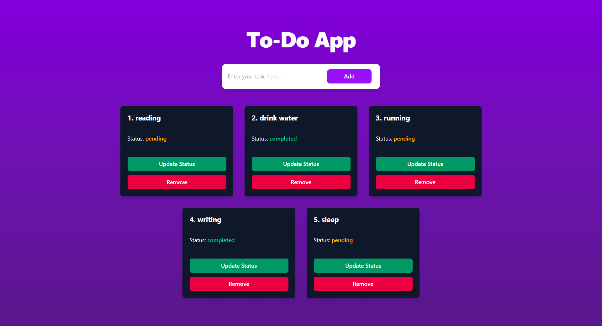

# To-Do List Application

A simple and responsive To-Do List application built with React and Tailwind CSS. It allows users to add tasks, track their completion status, and remove tasks. Tasks are saved in the browser's Local Storage, so they remain available after refreshing the page.

## Live Demo

🔗 **Live Website:** 

## Features

- Add new tasks
- Mark tasks as completed or pending
- Remove tasks
- Automatically save tasks using Local Storage
- Responsive user interface

## Tech Stack

- React
- JavaScript
- Tailwind CSS
- Vite
- Browser Local Storage

## Getting Started

### 1. Clone the repository

```bash
git clone https://github.com/AljuSabu/To-Do-List-Application
```

### 2. Navigate to the project folder

```bash
cd To-Do-List-Application
```

### 3. Install dependencies

```bash
npm install
```

### 4. Start the development server

```bash
npm run dev
```

Open the local URL displayed in your terminal to view the application.

## Build for Production

```bash
npm run build
```

## Screenshots



## Author

**Alju Sabu**

- GitHub: [AljuSabu](https://github.com/AljuSabu)
